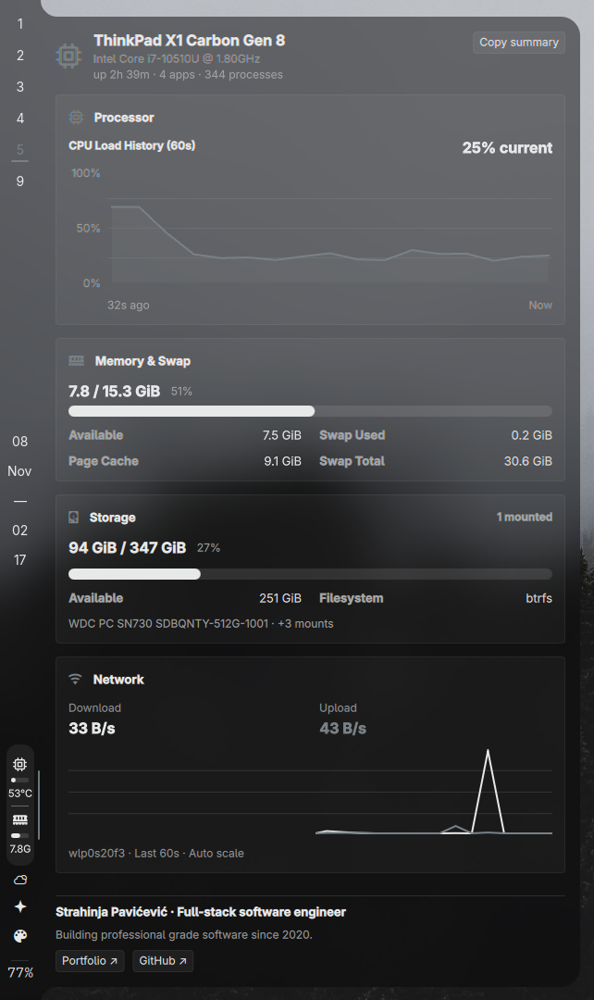

# Smon

A system monitor plugin for the Omarchy bar and sidebar. Plugin ID: `archy.smon`.



The vertical sidebar stacks each icon above a horizontal load bar and its reading: CPU temperature or used RAM. Smaller readings, extra vertical padding, and a divider before RAM keep the groups distinct. Clicking the widget opens a detailed system panel.

## Features

- CPU load, temperature, clock speed, and history.
- A Processor card shows the CPU history graph with percentage and time axis labels.
- Device model header with the CPU model beneath it.
- Header session stats show uptime, distinct apps with open Hyprland windows, and system process count. Copy summary sends the current device and resource readings to the Wayland clipboard using `wl-copy`.
- RAM usage and swap statistics.
- Memory card with a large used/total reading, usage bar, available RAM, swap usage, and visible cache details.
- GPU metrics when supported by the hardware and driver.
- Storage usage and top processes in the system panel.
- Network download/upload rates and a 60-second traffic graph, sampled every two seconds while the section is visible. The default IPv4 route selects the interface; otherwise the busiest observed interface is shown. Counters come from `/proc`, with no external requests.
- Processes use aligned App, CPU, and RAM columns, always group by app, and provide sort controls beside the section title.
- Theme colors, configurable item order, and panel sections.
- Horizontal bar support with icons, compact, full, and label modes.

## Requirements

Tested with Omarchy 4.5. The popup works with stock Omarchy. When the sibling `denon.bar` plugin is installed, Smon automatically uses its attached drawer styling; otherwise it uses Omarchy's standard popup.

An Omarchy installation with Quickshell shell plugin support. Hardware readings use Linux `/proc` and `/sys`; available metrics depend on your sensors and drivers. NVIDIA metrics require `nvidia-smi`. Process and session stats require Python 3. Storage discovery uses `findmnt` and `lsblk`. Copy summary requires `wl-copy`.

## Install

```bash
omarchy plugin add https://github.com/Strahinja2112/smon.git --enable
```

For a vertical sidebar, place Smon in the bottom section:

```bash
omarchy bar move archy.smon --section right --index 0
```

On Denon's bar, use `--after denon.tray` instead of `--index 0` to put it after the background-apps arrow.

If the plugin does not appear, restart the shell:

```bash
omarchy restart shell
```

## Controls

- Left click: open the system panel.
- Right click: cycle display modes.
- Middle click: refresh readings.
- Hover: view hardware details.

Temperature appears when a supported sensor is available. Memory readings use binary units (GiB); the compact sidebar suffix is `G`.

## Settings

Examples:

```bash
omarchy bar set archy.smon mode compact
omarchy bar set archy.smon showGauges true --json
omarchy bar set archy.smon showGpu false --json
omarchy bar set archy.smon fahrenheit true --json
```

The full settings schema is in [manifest.json](manifest.json). Display modes mainly affect the horizontal bar; the vertical sidebar uses the stacked layout.

## Update

```bash
omarchy plugin update archy.smon
```

## Remove

```bash
omarchy plugin remove archy.smon
```

This removes the installed plugin through Omarchy's plugin manager. No system packages or third-party configuration files are installed or overwritten by Smon.

## Project structure

```text
manifest.json       Plugin identity, entry point, and settings
qml/                Widget, popup, service, and shared model
scripts/            Hardware, storage, and process helpers
preview.png         Current sidebar and popup screenshot
```

## Local development

```bash
git clone https://github.com/Strahinja2112/smon.git
cd smon
omarchy plugin validate .
node tests/model.test.cjs
```

Node.js is needed only for the model regression checks, not to run the plugin.

To install local changes, copy the runtime files into the plugin directory:

```bash
mkdir -p ~/.config/omarchy/plugins/archy.smon
cp manifest.json ~/.config/omarchy/plugins/archy.smon/
cp -r qml scripts ~/.config/omarchy/plugins/archy.smon/
omarchy restart shell
```

## Process information

The panel always groups processes by app. The inherited process helper also contains an ungrouped browser-domain hint mode, which can read browser process memory where Linux permits it; Smon does not enable that mode. Process labels and CPU snapshots are cached in a private file in the runtime directory. Process sampling stops when the panel closes or its section folds. Session stats use `/proc` and `hyprctl`; network rates use `/proc` without external requests. Clicking Copy summary writes the displayed system readings to your clipboard.

Plugins run with your user permissions inside the Omarchy shell. Review code before installing. The optional `clickCommand` setting executes a shell command when clicked.

## Credits and license

Smon adapts [zoltanf/omarchy-hw-monitor](https://github.com/zoltanf/omarchy-hw-monitor), which builds on [meviusisback/omarchy-hw-monitor](https://github.com/meviusisback/omarchy-hw-monitor) and [Edgar Silva's original project](https://github.com/edgarsilva/omarchy-hw-monitor).

The sidebar layout, popup, and plugin identity are customized here. The preview shows Smon running with Denon's optional attached drawer styling.

[MIT license](LICENSE). Original copyright notices are retained.
